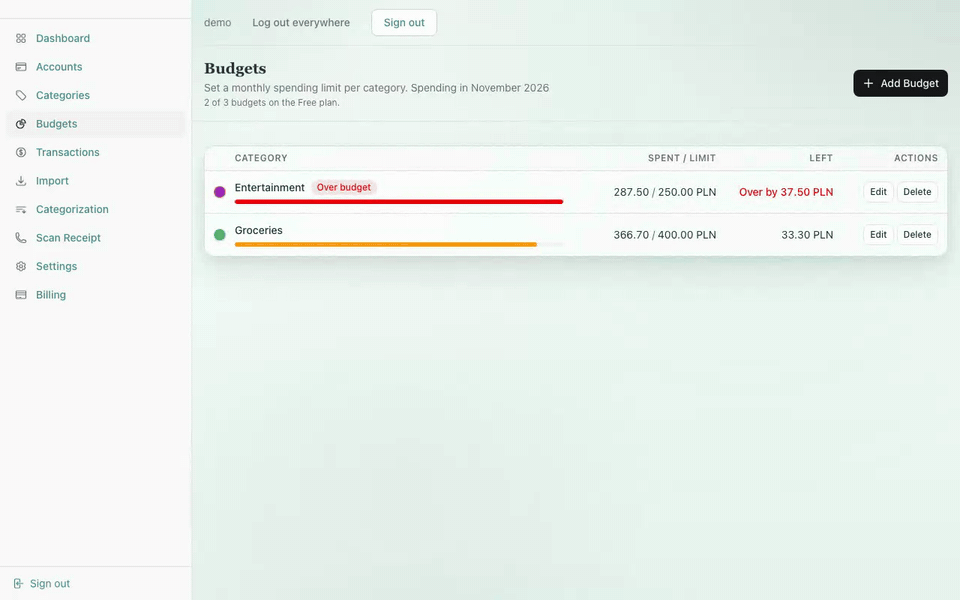
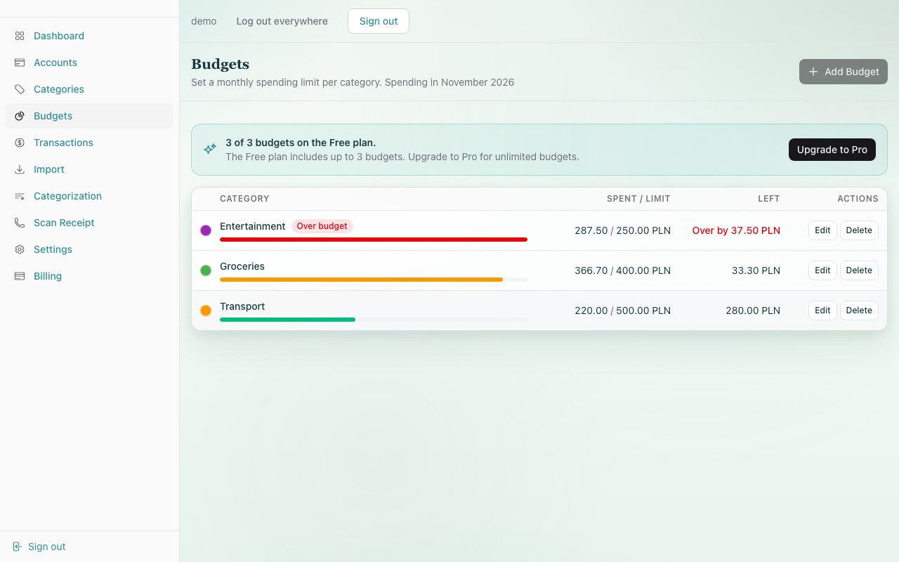
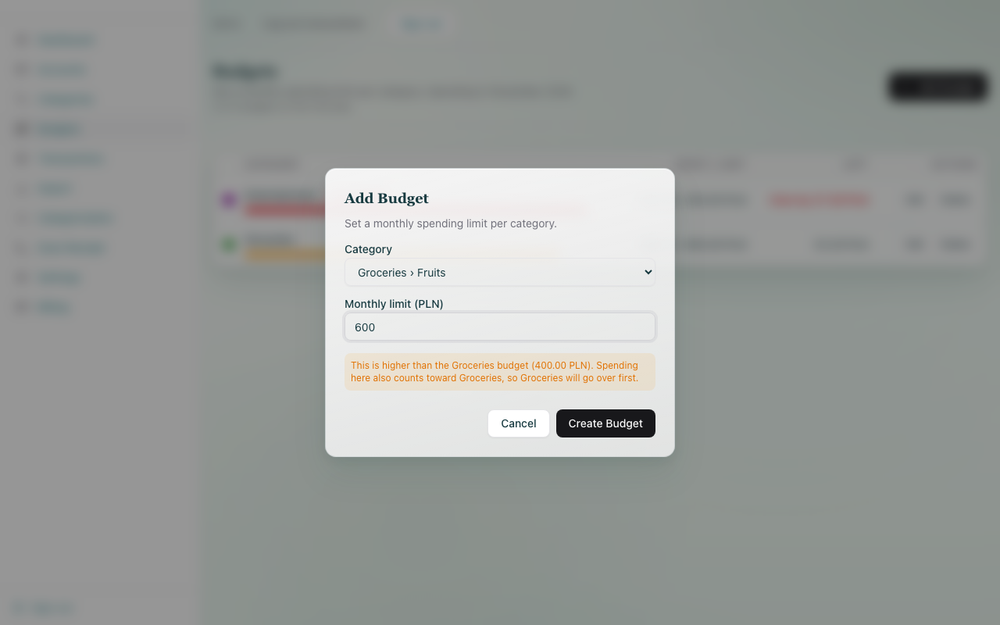
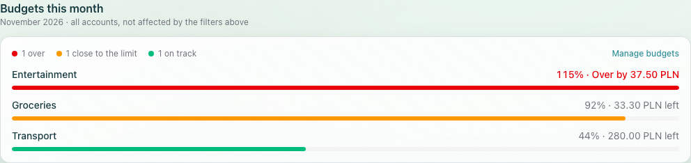
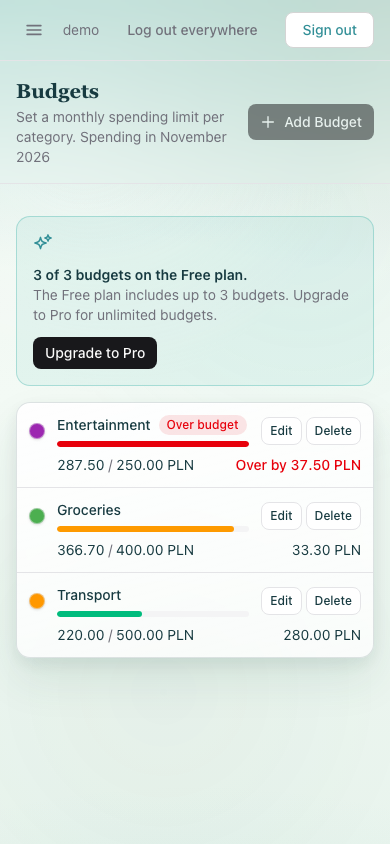

# Finance Tracker

A personal finance tracker: accounts, nested categories, transactions, bank
CSV import with auto-categorization rules, AI receipt scanning, spending
analytics, monthly category budgets, and Free/Pro plans.

Built with TanStack Start, Drizzle (Postgres via embedded PGlite), TanStack
Query, Tailwind/shadcn UI and Paraglide i18n.

## Features

- **Dashboard:** spending and income for a chosen period and account (totals,
  spending flow, top categories), plus this month's budgets.
- **Budgets:** a monthly spending limit per category, with progress, an
  over-budget email, and a Free-plan limit. See [Budgets](#budgets).
- **Accounts and categories:** multiple accounts, categories nested to any depth.
- **Transactions:** manual entry and editing.
- **Import:** CSV import (generic and bank-specific formats) with duplicate
  detection.
- **Categorization:** rules (with optional AI fallback) that categorize
  imported transactions and can be re-applied to existing ones.
- **Receipts:** scan a receipt image with an OpenAI-compatible model and save
  it as an expense with line items.
- **Billing:** Free and Pro plans via Stripe.
- **Privacy:** data export and account deletion (GDPR).

## Budgets



Set a monthly limit on any category and see how this month is going:



- **What counts:** expenses (negative amounts) dated in the current calendar
  month (UTC), in the budget's category **and all its subcategories**, at any
  depth. Income and refunds never reduce spending. Spending is computed when
  read, never stored, so budgets reset with the month on their own.
- **Progress:** spent / limit, what's left, and a bar that turns amber from 80%
  and red when over. "Over" means spent > limit; exactly at the limit is not
  over.
- **Parent and subcategory budgets** can coexist. A subcategory budget may be
  higher than its parent's; the dialog warns, since the parent includes the
  subcategory's spending and goes over first:

  

- **Over-budget email:** sent the first time a budget goes over in a month, at
  most once per budget per month, to verified email addresses. It's checked
  after every change that can move spending (saving, importing, scanning or
  recategorizing transactions, deleting categories, creating or lowering a
  budget), with an hourly sweep as a backstop.

  ```text
  Subject: Budget exceeded: Entertainment — Finance Tracker

  You've spent 287.50 PLN this month in Entertainment, over your monthly
  budget of 250.00 PLN.

  See your budgets: https://<your app>/budgets

  You get at most one of these emails per budget each month.
  ```

- **Plans:** Free includes up to 3 budgets (`BILLING_FREE_MAX_BUDGETS`); Pro is
  unlimited. After a downgrade, existing budgets keep working and only adding
  new ones is blocked.
- **Dashboard:** a "Budgets this month" section shows how many budgets are
  over, close to the limit or on track, with the most urgent first. It always
  covers the current month across all accounts, regardless of the dashboard's
  filters.

  

- **Privacy:** budgets and the record of sent alerts are included in the data
  export and removed on account deletion; deleting a category deletes its
  budgets.



**Known limitations:** a transaction counts toward the budget of its own
category; items on a scanned receipt don't move spending into their own
categories. Amounts from all accounts are summed in one currency, as
elsewhere in the app. "This month" is the UTC calendar month.

## Getting started

Requirements: Node.js 22+ and pnpm 10 (`corepack enable` picks up the pinned
version). Use `pnpm`, not `npm`.

```bash
pnpm install
pnpm exec playwright install chromium   # for E2E tests
echo "AI_FAKE=1" > .env.local           # fake AI responses, no API key needed
pnpm run seed:demo                      # demo user with three months of data
pnpm run dev                            # http://127.0.0.1:3000
```

Log in as `demo@example.com` / `demo-password`. No other setup is needed: the
database is an embedded PGlite instance under `./data/pg`, and emails are
printed in the dev server's terminal. See `.env.example` for optional settings
(Postgres, S3, Stripe, Resend, an AI provider).

The dev server and the seed both open `./data/pg`, which only one process can
use at a time: stop the dev server before seeding, and before
`pnpm run check` (its E2E tests start their own server on port 3000).

## Scripts

| Command | What it does |
| --- | --- |
| `pnpm run dev` | Dev server on http://127.0.0.1:3000 |
| `pnpm run build` / `pnpm run start` | Production build and server |
| `pnpm run check` | Typecheck, lint, unit tests and E2E tests |
| `pnpm run test` / `pnpm run test:e2e` | Unit tests (Vitest) / E2E tests (Playwright) |
| `pnpm run db:generate` | Generate a Drizzle migration from `src/db/schema.ts` |
| `pnpm run seed:demo [--reset]` | Create a demo user (`demo@example.com` / `demo-password`) with three months of data and three budgets in the local database (stop the dev server first) |
| `pnpm run readme:media` | Regenerate the screenshots and GIF in `docs/screenshots/` from a running dev server and a freshly seeded demo user (needs `ffmpeg`) |
| `pnpm run i18n:compile` | Compile Paraglide messages from `messages/` |

## Architecture

**Stack:** TanStack Start (React 19, server rendering via Nitro on Vite) with
file-based TanStack Router routes; TanStack Query on the client; Drizzle ORM
on Postgres (embedded PGlite locally, in memory for tests, or any Postgres via
`DATABASE_URL`); Zod for input validation; Tailwind and shadcn/Radix UI;
Paraglide for all UI text. Money is stored as integer minor units.

**Layout:**

- `src/db/`: Drizzle schema and migration runner; migrations live in `drizzle/`
  and run at server start.
- `src/server/`: `*.functions.ts` are server functions (`createServerFn`), the
  only server code routes import; `*.server.ts` hold server-only logic and
  queries.
- `src/routes/`: pages (`_authed/*` require a signed-in user) and server routes.
- `src/components/`, `src/lib/`: shared UI and client-safe helpers.
- `messages/`: UI strings. `tests/`: unit tests; `tests/e2e/`: Playwright.

**How a feature flows:** a table in `src/db/schema.ts` (always with a
`user_id`) → queries in `*.server.ts`, scoped by user → server functions in
`*.functions.ts`, which validate input with Zod and call `requireUserId()` →
a route that calls them through `useServerFn` with TanStack Query and
invalidates its query keys after mutations.

**Cross-cutting pieces:**

- **Auth:** sessions are encrypted, signed cookies, checked against the
  database on every server function call; the `_authed` layout only
  redirects, the server functions enforce access.
- **Plans:** `getEntitlements` and the `check*Limit` helpers in
  `billing.server.ts`; limits are configured in `src/server/env.ts`.
- **Email:** `sendEmail` prints to the console in development, is captured in
  memory under test, and uses Resend in production.
- **Background work:** an hourly in-process sweep (GDPR deletions, data
  retention, over-budget alerts).
- **Tests:** unit tests run against an in-memory database; E2E tests build and
  run the production server and create a fresh user per test.

Coding conventions are in [CLAUDE.md](CLAUDE.md) (identical to
[AGENTS.md](AGENTS.md)).
